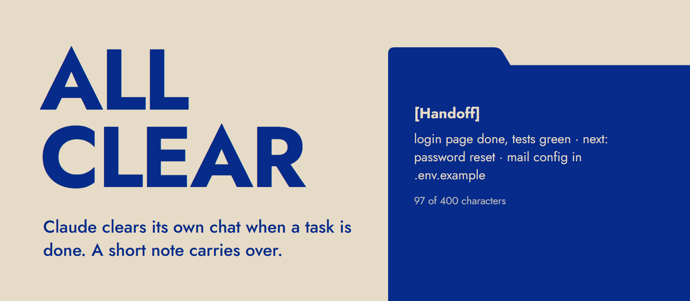
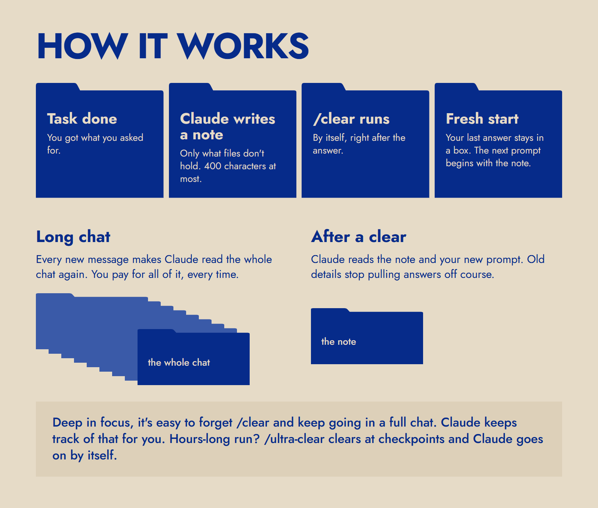

<picture>
  <source media="(prefers-color-scheme: dark)" srcset="assets/banner-dark.png">
  
</picture>

# all-clear

A plugin for Claude Code. When a task is done, Claude clears its context window by itself and keeps a short handoff note for the next task. Your last answer stays on screen in a box. For tasks that run for hours, `/ultra-clear` clears at checkpoints and Claude goes on by itself. A Codex CLI version is included.

Short chats cost fewer tokens and keep Claude on track.

## Install

In Claude Code, type:

```
/plugin install all-clear --marketplace nzagros/all-clear
```

Press `y` to add the marketplace, then Enter for the user scope. Done. It works in every new session.

From a shell instead:

```
claude plugin install all-clear --marketplace nzagros/all-clear
```

In the desktop app: click **+** next to the prompt box, then **Plugins**, **Add marketplace**, type `nzagros/all-clear`, then **Add plugin**.

Using Codex? See [Codex](#codex) below.

## How it works

<picture>
  <source media="(prefers-color-scheme: dark)" srcset="assets/how-it-works-dark.png">
  
</picture>

1. You finish a task with Claude.
2. Claude checks: does the next task need this chat? If no, it writes a handoff note. 400 characters at most. Only facts that are not in your files.
3. After its answer, `/clear` runs by itself.
4. Your next prompt starts with the note:

```
[Handoff]
login page done, tests green · next: password reset · mail config in .env.example

[Task]
your next prompt
```

If Claude already knows the next task, it starts it right away in the fresh chat.

## Your last answer stays on screen

After the clear, Claude's last answer is shown in a box at the top of the fresh chat. A list or a draft you asked for is still there to read, and the **Copy** button puts it on your clipboard. The box is drawn by the plugin alone: Claude does not read it, and it costs no tokens. It is not saved in the chat, so `--resume` does not bring it back.

Claude also holds back the clear when its answer is something you asked to see, since you may want to follow up on it. It clears at the end of a later turn instead.

## Ultra-clear for long runs

Some tasks run for hours inside one prompt. Type `/ultra-clear` to switch it on for the session (`/ultra-clear off` to stop). A row above the prompt shows `ultra-clear on` while it runs. The mode stays on through each clear and a reload of the plugin; a restart of Claude Code switches it off.

Once the chat has grown by about 60,000 tokens, Claude gets a hidden reminder with each tool result. At the next clean checkpoint, with a step finished and saved, it:

1. writes the goal, what is done, the decisions and the remaining steps to a state file (the project's plan or TODO file if there is one),
2. clears with a handoff that names the file and the next step,
3. goes on by itself in the fresh chat. You type nothing.

If Claude passes a reminder by, it comes back after about 10,000 more tokens, marked overdue. Claude only sees the reminder after a tool call, which a long run makes all the time.

The handoff may hold up to 1,200 characters in this mode. After 30 automatic continues in a row the plugin pauses and keeps the handoff for your next prompt, so a run cannot loop forever. Press Esc to stop at any time; an interrupted turn does not clear.

## Skipped questions

Claude asks you something, and you move on to another topic without answering. The question no longer holds the chat open. Claude decides whether to clear. If the question matters, it goes into the note:

```
[Handoff]
covers v5 done, files in Downloads/covers

[Skipped question]
Send the covers to the client now?

[Task]
your next prompt
```

Claude does your new task first, then asks the skipped question once more in one short line. Unimportant questions are dropped.

## Why it saves tokens

Each message you send makes Claude read the whole chat again. In a chat of 80,000 tokens, even "thanks" sends 80,000 input tokens. Prompt caching makes the repeats cheaper, but they still cost and still fill the context window. After a clear, Claude reads the note and your new prompt.

Old details also pull answers off course. A fresh chat with a short note keeps Claude on the current task.

## The reminder

Once a chat has grown by about 20,000 tokens since the last clear, every prompt carries a hidden one-line reminder for Claude: check whether this chat is still needed. You see nothing. Claude decides.

Deep in focus, it's easy to forget `/clear` for hours. The reminder keeps track of that for you.

## Work with it

- One chat per task. Say what you want, let Claude finish, let it clear.
- Keep decisions in files (a README, a TODO, a plan). Claude reads files again after a clear. Chat history is gone.
- Want to keep the chat? Say "don't clear yet" or "I'll come back to this".
- Coming back to a long task tomorrow? Ask Claude to write the state into a file first.
- Clear by hand any time with `/clear`. The plugin adds to it and changes nothing about it.

## When Claude does not clear

- in the middle of a task
- while it waits for your answer (a question you skipped by moving on does not count)
- when you said you'll come back to details from this chat
- inside subagents

## Codex

Codex has no way for a plugin to clear the chat. The Codex version does the part it can: at the end of a finished task in a long chat, Codex writes the note and tells you to type `/clear` and paste it.

```
codex plugin marketplace add nzagros/all-clear
codex plugin add all-clear@all-clear
```

## Requirements

- Claude Code with plugin hooks modules. Tested on 2.1.325.
- Codex CLI with plugins. Tested on 0.165.0.

## Change the numbers

The limits sit at the top of `hooks/register.tsx`:

- `MAX_HANDOFF = 400` (characters in the note)
- `MAX_QUESTION = 200` (characters in a skipped question)
- `NUDGE_TOKENS = 20_000` (growth before the reminder starts)
- `ULTRA_TOKENS = 60_000` (growth before ultra-clear asks for a checkpoint)
- `MAX_HANDOFF_ULTRA = 1200` (characters in the note in ultra-clear mode)
- `ULTRA_REPEAT = 10_000` (growth before a passed-by checkpoint reminder comes back)
- `MAX_CHAIN = 30` (automatic continues in a row before ultra-clear pauses)

## Uninstall

```
/plugin uninstall all-clear
```

## Files

- `hooks/register.tsx`: the Claude Code plugin (tool, clear, handoff, answer box, reminder, ultra-clear)
- `hooks/register.test.tsx`: tests, run with `claude plugin test .`
- `types/index.d.ts`: the plugin's session state (the ultra-clear switch)
- `codex/skills/all-clear/SKILL.md`: the Codex version
- `assets/src/`: source of the pictures (HTML, rendered with Playwright)

The pictures use [Jost](https://fonts.google.com/specimen/Jost) by indestructible type*, SIL Open Font License 1.1.

## License

MIT
